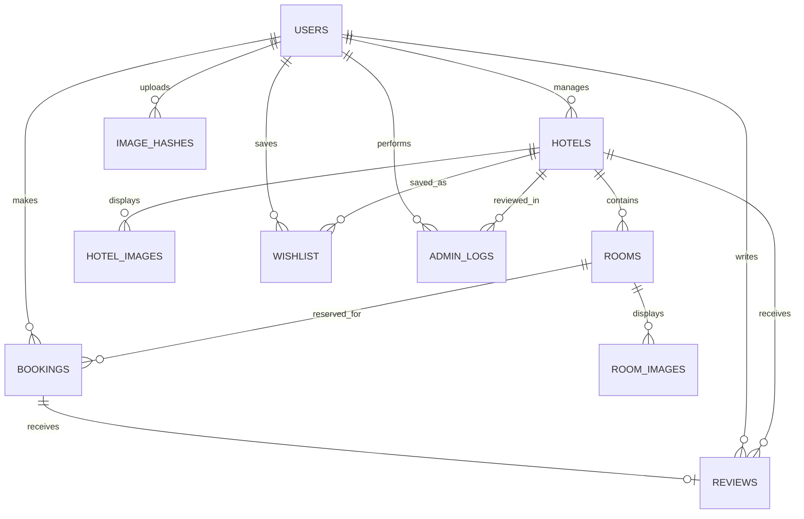

# Stayora — project explanation

Stayora is an original hotel discovery and booking demo with a warm beige/red design. Seed images are unique illustrated placeholders; replace them with licensed property photos.

## Technology

| Technology | Why | Where | How |
|---|---|---|---|
| Node.js | One local runtime | `server.js`, `seed.js` | Runs API and setup scripts. |
| Express | Simple REST server | `server.js` | Routes API calls and serves the frontend. |
| SQLite / better-sqlite3 | Portable relational database | `server.js`, `stayora.db` | Creates tables/indexes on first run; bound SQL parameters protect user input. |
| HTML/CSS/vanilla JS | No frontend build step | `public/` | Renders pages and calls JSON endpoints. |
| bcryptjs/JWT | Password security and sessions | `/api/auth` | Hashes passwords; verifies signed tokens and reloads role/status for every protected request. |
| Multer/Sharp | Upload and image processing | photo endpoints | Limits uploads and decodes/resizes photos to compute perceptual hashes. |
| SHA-256/dHash | Exact and visual duplicate guard | `image_hashes` | SHA catches exact bytes; dHash compares 64 adjacent-pixel differences. |
| Helmet/rate-limit/dotenv | Headers, request throttling, config | `server.js`, `.env.example` | Adds browser security headers, limits API calls, loads secrets from environment. |

## Folder structure

- `server.js`: schema, API routes, authorization, booking transaction, image hashing and assistant.
- `seed.js`: demo accounts, original illustrated images, hotels, rooms and sample history.
- `smoke-test.js`: API workflow and security smoke test.
- `package.json`: dependencies and `start`, `seed`, `test` commands.
- `.env.example`: JWT secret, port and optional AI key template.
- `public/index.html`: main page structure.
- `public/styles.css`: responsive style system and components.
- `public/app.js`: search, auth, details, booking, dashboards and chat UI.
- `uploads/`: generated demo artwork and UUID-named user uploads.
- `README.md`: setup and demo instructions.

## Database ER diagram

### Tables

- `users`: name, unique email, password hash, role and block status.
- `hotels`: manager, listing details, unique licence, status and rejection reason.
- `hotel_images`, `room_images`: image filename and exact/perceptual hash.
- `rooms`: INR nightly rate, capacity, quantity and amenities.
- `bookings`: guest, room, dates, calculated total and payment/status.
- `reviews`: one rating and comment per booking.
- `wishlist`: traveller's saved properties.
- `admin_logs`: timestamped approval/rejection actions.
- `image_hashes`: global duplicate index across hotel and room uploads.

Foreign keys and indexes are enabled. Hotels are indexed by status/city; bookings by room/date/status.

## Flows

### Booking

1. Traveller chooses room, dates and guests.
2. Server validates future check-in, checkout order, guest count and capacity.
3. A SQLite transaction counts active reservations overlapping the requested interval (`existing.check_in < requested.check_out` and `existing.check_out > requested.check_in`).
4. If occupied rooms equal quantity, the API rejects with HTTP 409. Otherwise the server calculates nightly price × nights and inserts a demo-paid booking.
5. Confirmation returns a booking ID. No actual payment occurs.

### Hotel verification

1. Manager submits details and at least 3 photos.
2. Server checks required data, licence format/uniqueness, same-name/address collision, phone/email, file format/size and global photo hashes.
3. Listing starts `PENDING` and customer search only includes `APPROVED` records.
4. Admin inspects details and photos, approves or rejects with a reason. Action goes to `admin_logs`.
5. Rejected manager can fix and resubmit.

### Photo duplication

Multer stores under UUID names. Sharp decodes each image, scales to 9×8 grayscale, and compares 64 neighboring-pixel pairs to create dHash. Upload is rejected when SHA-256 exactly matches or dHash Hamming distance is ≤5 from any previous upload, even within the same listing. Rejected files are deleted. This detects previously uploaded copies, not unseen photos from public sites; manual admin review is needed. Google Vision Web Detection or TinEye are possible reverse-image-search upgrades.

### Hotel Manager Advertising & Property Boost Engine

1. Hotel Managers have an exclusive advertising console in their portal (`POST /api/manager/hotels/:id/promote`, protected by RBAC `roles('manager')`) allowing them to boost verified properties.
2. The boost feature is strictly manager-only; travellers and general visitors have no access to boost controls.
3. Once boosted, the property is elevated on the public explore page, displaying prominent **📢 ADVERTISEMENT** badges on cards, guaranteed #1 search ranking, and the luxury front-page **Featured Advertisement Spotlight Banner** displaying the manager's custom promotional headline (e.g. complimentary breakfast & sunset cruises).

### Traveller Stay Feedback & Verified Review System

1. Travellers who book a stay can leave authentic feedback directly from their personal **My Bookings** dashboard (`POST /api/reviews` & `PUT /api/reviews/:bookingId`).
2. An interactive 5-star rating widget provides real-time hover feedback and descriptors (Exceptional, Very Good, Average, Disappointing, Poor) along with 1-click trip highlight tags (*Spotless Clean, Delicious Breakfast, Hospitable Host, Superb Amenities*).
3. Feedback is verified: only travellers with a confirmed booking reference can submit reviews.
4. Submitting feedback dynamically updates the hotel's public rating and review count (`SELECT ROUND(AVG(rating),1)`), renders in the hotel modal's **Verified Guest Reviews**, and appears in real time on the Hotel Partner's console under **Guest Reviews & Feedback**.
5. Travellers can view, re-read, and edit their submitted feedback anytime.

### Assistant

The offline built-in mode extracts common city, budget, guests, dates and supported amenities from text. It searches approved listings and checks dates against booking records, then links to hotel details. It can answer basic booking/cancellation FAQs and asks for city/budget if both are missing. It never books or exposes another traveller's data. When `ANTHROPIC_API_KEY` is set, the server calls Claude with a constrained `search_hotels` tool. The tool runs the same approved-only, date-availability database search; only returned rows are rendered as cards. Failed Claude calls automatically fall back to the offline parser. The key stays on the server.

## Security

- Passwords use bcrypt; JWT is signed and account role/block state is reloaded on every protected API request.
- Role middleware guards each manager/admin/customer endpoint; manager queries constrain hotel ownership.
- Admin registration is prohibited; admin role is seeded.
- SQL uses parameterized statements. A generated manager dashboard placeholder list is based only on integer hotel IDs loaded from SQLite.
- Helmet sets security headers; rate limiting applies to API calls.
- Uploads have count/size/type/decode checks and random filenames.
- Booking overlap and insert run in one transaction; total price is server calculated.

## Setup and role demo

Use the five steps in `README.md`. Demo accounts:

| Role | Login |
|---|---|
| Admin | `admin@stayora.com` / `Admin@123` |
| Manager | `manager@stayora.com` / `Manager@123` |
| Traveller | `user@stayora.com` / `User@123` |

Seed data includes approved stays in Bengaluru, Mysuru, Goa, Jaipur, Munnar and Udaipur, pending and rejected listings, multiple rooms, and sample past/upcoming bookings and a review. To demo: browse/search and book as traveller; submit a 3-photo property and manage rooms/bookings as manager; then approve/reject and inspect audit log as admin.

## Limitations and future work

- Demo payment only; add a payment provider and verified webhooks for real payments.
- Assistant is rule-based by default. Optional Claude tool calling needs an Anthropic API key and network access; provider use may incur API charges.
- Seed images are placeholders; add licensed photos. Manual review is still required.
- No email notifications, maps, password reset, reverse-image search or production cookie/CSRF design.
- Manager occupancy is calculated over the next 30 days from room-night availability; production reporting could offer custom date windows.
- SQLite fits a student laptop; a production multi-instance service should use server DB, durable object storage and background processing.

## Viva questions

1. **Why SQLite?** Transactional relational storage without a separate service.
2. **Why bcrypt?** It hashes passwords with a tunable, intentionally expensive work factor.
3. **What is JWT for?** A signed login token; server still reloads permissions from the user table.
4. **Where is RBAC enforced?** Server middleware on protected API routes.
5. **How does double-booking prevention work?** A transaction checks overlapping bookings before insertion.
6. **How do date ranges overlap?** Existing start is before requested end and existing end after requested start.
7. **Why price on server?** Client totals can be manipulated; room rate is read from DB.
8. **What does SHA-256 detect?** Byte-identical copies regardless of filename.
9. **What is dHash?** A perceptual signature from neighboring grayscale pixel comparisons.
10. **Why use both hashes?** SHA finds exact matches; dHash finds close visual copies.
11. **What is distance ≤5?** At most five differing bits among the 64-bit signatures.
12. **Can this detect every copied online image?** No, only copies similar to platform uploads.
13. **Why hide pending listings?** Approval prevents unreviewed hotels from being published.
14. **Why parameterized SQL?** It separates data from SQL syntax to limit injection.
15. **What would production need?** Real payment webhooks, notifications, scalable storage, privacy controls and image-search integration.

## David Hooker's Seven Principles in Stayora (Expo Special)

In software engineering, David Hooker articulated seven fundamental principles that govern pragmatic, high-quality system design. Stayora directly models each one:

| Principle | Concept | Implementation in Stayora |
|---|---|---|
| **1. The Reason It All Exists** | Provide value to users. | Eliminates fake hotel listings and recycled public photos via SHA-256 + 64-bit dHash fraud checks and admin verification before publication. |
| **2. KISS (Keep It Simple, Stupid!)** | As simple as possible, no simpler. | Zero-build Vanilla JS frontend, single-file schema migration, and embedded SQLite. Sub-50ms paint times and no fragile bundler toolchains. |
| **3. Maintain the Vision** | Clear, unified architectural and visual direction. | Consistent boutique warm-terracotta palette, strict 3-tier RBAC (`user`, `manager`, `admin`), and uniform parameter validation across all routes. |
| **4. What You Produce, Others Will Consume** | Design for other people to read, use, and evaluate. | Expo 1-Click Fast Switcher (`Traveller`, `Manager`, `Admin`), printable boarding passes with SVG QR codes, and clear API error contracts. |
| **5. Be Open to the Future** | Don't design into a dead end; accommodate change cleanly. | Dual-engine AI Assistant: works completely offline with heuristic regex parsing, and automatically connects to Claude Haiku tool calling if an API key is supplied. |
| **6. Plan Ahead for Reuse** | Reusable components and patterns. | Modular modal system, parameterized SQL queries, shared dHash Hamming distance calculator, and reusable card & badge tokens. |
| **7. Think!** | Complete thought before action produces robust software. | ACID transaction locks prevent race-condition room double-bookings (`existing.check_in < requested.check_out AND existing.check_out > requested.check_in`) and photo hashing runs before filesystem persistence. |

